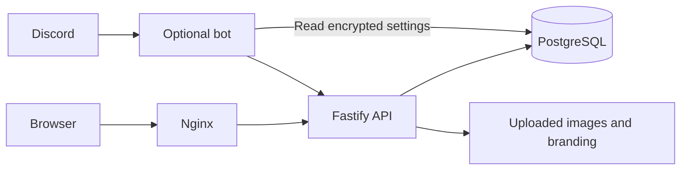

# Architecture

The `clan-clog` image runs PostgreSQL 17, Nginx, a Fastify API and an optional Discord bot in one container. A root supervisor initializes storage and PostgreSQL, then starts application processes as UID 1000 and PostgreSQL as UID 999. One persistent `/data` volume holds the installation. PostgreSQL listens only on loopback and a private Unix socket.

| Folder              | Responsibility                                                    |
| ------------------- | ----------------------------------------------------------------- |
| `apps/web`          | React/Vite public log and staff tools                             |
| `apps/api`          | Authentication, reads, intake, reviews, catalog and competitions  |
| `apps/bot`          | Discord commands and saved configuration; submissions use the API |
| `packages/domain`   | Shared validation, item identity, world modes and exact XP        |
| `packages/database` | Database setup, catalog import, permissions and maintenance       |
| `infra`             | Nginx, process supervisor, deployment and recovery                |
| `catalog`           | Pinned catalog inputs, identity mapping and asset provenance      |

PostgreSQL is authoritative. An item has one canonical ID across every page.
Approval grants Regular or Event credit. Normal-world items can have one Event
credit per canonical item/page pair and independent Regular credits; the regular
duplicate filter controls Regular repeats in each world mode. Hardcore supports Regular only. Rejection
and revocation grant no credit. Claims, receipts and audits remain private.
Revisions prevent one staff edit from overwriting another. Request keys let
clients retry uncertain writes without creating a second submission or import.

Bootstrap initializes a fresh database with `001_baseline.sql`, applies pending
migrations, imports the catalog and provisions
`clog_runtime`. Only bootstrap/maintenance gets owner credentials. Startup
checks migration names and checksums; incompatible history fails before writes.
New migrations upgrade existing installations without recreating their data.
Databases with pre-release or incompatible migration checksums are unsupported.

Public reads use revision-based ETags and visibility-aware polling. Staff routes
load code and data together and clear private state on access loss. Production
builds exclude tests and fixture data. Item icons, fonts, UI art, logos and
uploads are served locally; the browser never fetches WOM results directly.

## Web styling

`apps/web/src/style.css`, imported once by `main.tsx`, owns the public site and
staff UI. Its root block defines semantic custom properties for surfaces, text,
borders, control states, feedback, typography, spacing and elevation. Change a
shared role there instead of introducing a route-specific copy of its value.
Keep roles distinct even when their initial colours match. `--game-*` roles
preserve the collection log's game palette separately from ordinary form controls.

Reuse `.site-button` (with `--approve` or `--danger` variants), `.admin-panel`,
`.admin-fieldset`, `.admin-input`, `.admin-checkbox`, `.admin-note`,
`.admin-error`, `.admin-warning`, `.admin-success` and `.admin-badge` for shared
controls, panels and feedback. Every native modal uses `.site-dialog` plus a
feature class for its width and layout; `--dialog-padding` adjusts its content
inset. Body portals use `.site-tooltip` plus `.item-menu` or `.xp-tooltip`.
These primitives inherit root tokens without depending on the active route,
an ancestor panel or lazy-load order. Base selectors use `:where()` so explicit
component and state classes can override them without `!important`.

Keep feature geometry alongside the feature's rules and responsive overrides at
the end of the stylesheet. The native log dimensions, sprites and pixel artwork
are intentional variants, not general spacing tokens. Static presentation belongs
in CSS. Inline styles are reserved for measured portal coordinates, log scale,
count geometry and administrator-configured highlight/colour previews. Keep these
values local to their elements; do not duplicate the theme in JavaScript or move
configured colours into root defaults. When changing shared roles, check public
and staff views, body portals and top-layer dialogs at desktop and narrow widths;
the focused browser scenarios are described in [local testing](local-testing.md).

## Application wording

`packages/domain/src/text.ts` is the code-maintained source for shipped application
wording. Import its named feature exports through `@clog/domain`, for example
`import * as appText from '@clog/domain'` and
`appText.webCollectionLogItemLabel(name, collected, hardcore, count)`. Each feature
contains semantic labels, complete messages and typed formatters; shared messages
also supply API errors and the browser/bot allowlists that recognize them.
Use direct named entries so public pages do not load staff or server wording.
The module is pure and browser-safe; rendering, date/number formatting and React
markup stay in the consuming layers. Structured parts such as `webSiteAppFooterCredits`
keep link labels and surrounding words together without embedding HTML.

Existing `defaultSiteCopy`, `defaultSubmissionHelp`, skill labels and validation
exports refer to this source. It owns shipped defaults, while saved regular and
Hardcore settings and submission instructions still take precedence. Editing a
default does not rewrite persisted administrator text, audit history or receipts.
Vite injects the initial HTML title from the same collection-title default in
development and production. The production Vite compiler resolves catalog reads
to ordinary string/object expressions and complete formatter calls. This removes
catalog lookup overhead without shipping unused staff/server text; development
uses the same typed exports directly. Formatter arguments still evaluate once.
Avoid collecting the whole catalog in a runtime object, spreading a text namespace,
or looking up exports dynamically. Rendering continues to escape text normally.

Route/asset paths, enum IDs, environment names, SQL, HTTP/cookie formats, selectors
and command/option identifiers remain contracts in their existing layers.
Imported catalog/WOM names and user input retain their sources. The pinned legacy
clue taxonomy correction and its immutable audit reason are historical evidence.
Build-tool diagnostics are separate from live application wording.
ESLint's `copy/canonical-text` rule and `npm run check:text` enforce the authored
text boundary; see [focused checks](local-testing.md#focused-checks).

See [security](security.md), [contracts](contracts.md), [testing](local-testing.md)
and [recovery](release-recovery.md) for the operational boundaries.
