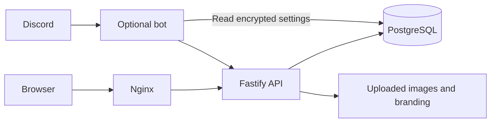
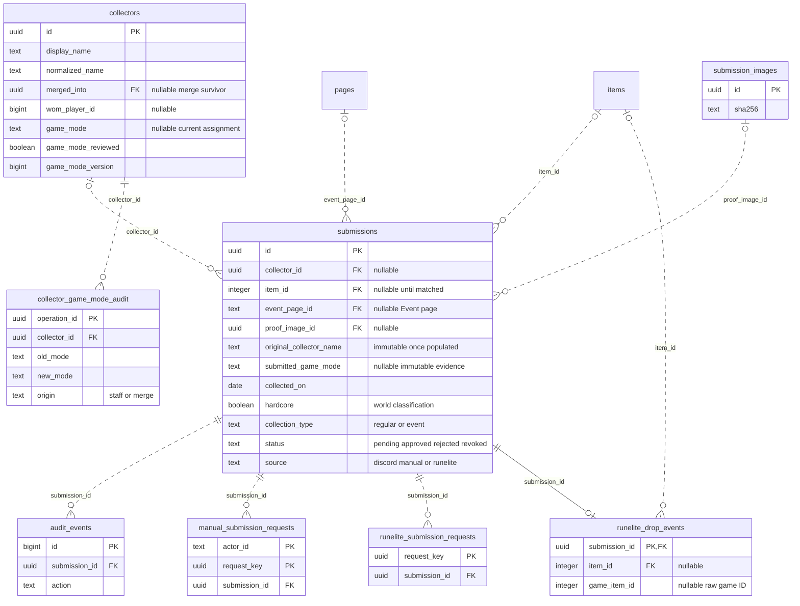
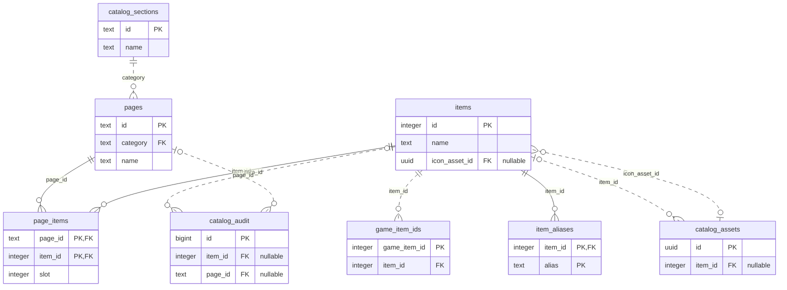
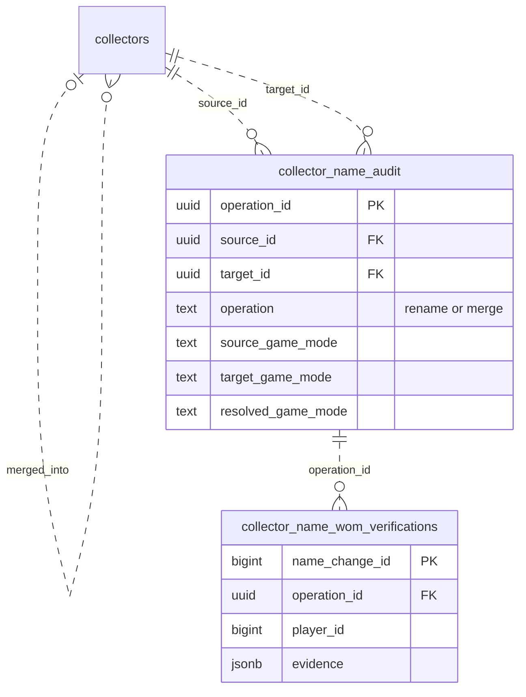
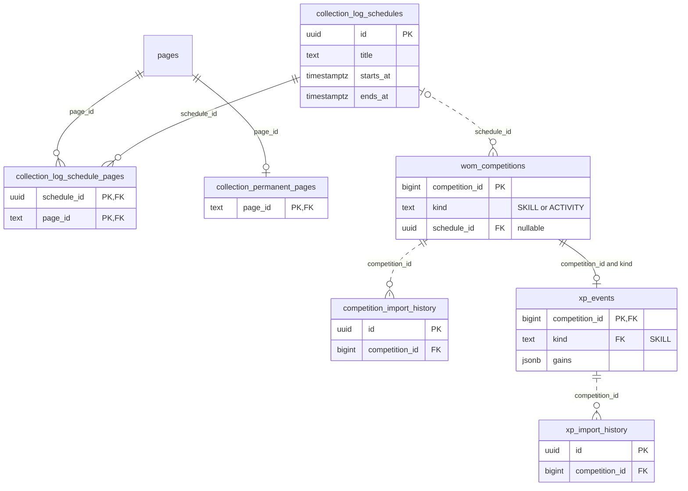
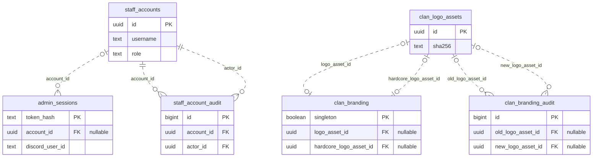
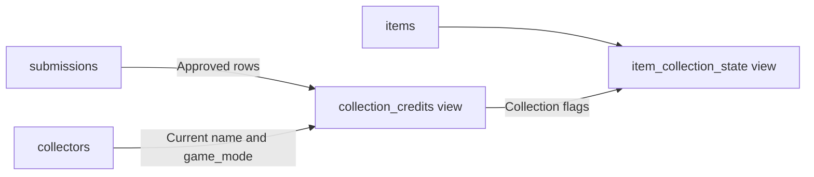

# Architecture

The `clan-clog` image runs PostgreSQL 17, Nginx, a Fastify API and an optional Discord bot in one container. A root supervisor initializes storage and PostgreSQL, then starts application processes as UID 1000 and PostgreSQL as UID 999. One persistent `/data` volume holds the installation. PostgreSQL listens only on loopback and a private Unix socket.

| Folder              | Responsibility                                                    |
| ------------------- | ----------------------------------------------------------------- |
| `apps/web`          | React/Vite public log and staff tools                             |
| `apps/api`          | Authentication, reads, intake, reviews, catalog and competitions  |
| `apps/bot`          | Discord commands and saved configuration; submissions use the API |
| `packages/domain`   | Shared validation, item identity, world modes and exact XP        |
| `packages/database` | Database setup, catalog import, permissions and maintenance       |
| `infra`             | Nginx, process supervisor, deployment and recovery                |
| `catalog`           | Pinned catalog inputs, identity mapping and asset provenance      |

PostgreSQL is authoritative. An item has one canonical ID across every page.
Approval grants Regular or Event credit. Normal-world items can have one Event
credit per canonical item/page pair and independent Regular credits; the regular
duplicate filter controls Regular repeats in each world mode. Hardcore supports Regular only. Rejection
and revocation grant no credit. Claims, receipts and audits remain private.
Revisions prevent one staff edit from overwriting another. Request keys let
clients retry uncertain writes without creating a second submission or import.

Bootstrap initializes a fresh database with `001_baseline.sql`, applies pending
migrations, imports the catalog and provisions
`clog_runtime`. Only bootstrap/maintenance gets owner credentials. Startup
checks migration names and checksums; incompatible history fails before writes.
New migrations upgrade existing installations without recreating their data.
Databases with pre-release or incompatible migration checksums are unsupported.

Public reads use revision-based ETags and visibility-aware polling. Staff routes
load code and data together and clear private state on access loss. Production
builds exclude tests and fixture data. Item icons, fonts, UI art, logos and
uploads are served locally; the browser never fetches WOM results directly.

## Collection HiScores read model

The public ranking reads approved submissions joined once to active canonical
items and their current surviving collectors. It never joins page memberships or
aliases, so repeated pages cannot inflate obtain counts. Stored normalized
collector names supply exact search and deterministic score/name/identity ordering.
Normal and Hardcore world scopes are independent of account game mode.

The API derives ranking positions, totals and one 25-player page in a repeatable-read
transaction, using the existing collection projection and site-setting revisions.
The per-store cache holds one selection/revision rather than accumulating a cache
per player or page. No separate ranking table or schema migration is needed.
The browser loads the ranking route before committing navigation, then uses the
shared visibility-aware poller and conditional requests. Its bounded last-result
cache also recognises the clamped/search-result URL, avoiding an extra initial
read after canonicalizing that URL. Replaced selections abort their reads and
cannot replace the new view. XP page code also loads through route preparation;
public ranking code does not enter the initial collection-log bundle.

Metric/page and a submitted search selection live in the URL. Search changes
history; a coherent read may replace its page when the matched rank moves or a
requested page becomes out of range. Pagination/category changes clear the active
search highlight. Input drafts stay local, including while live scores refresh.
See [the API contract](contracts.md#collection-hiscores) for score and visibility rules.

## Web styling

`apps/web/src/style.css`, imported once by `main.tsx`, owns the public site and
staff UI. Its root block defines semantic custom properties for surfaces, text,
borders, control states, feedback, typography, spacing and elevation. Change a
shared role there instead of introducing a route-specific copy of its value.
Keep roles distinct even when their initial colours match. `--game-*` roles
preserve the collection log's game palette separately from ordinary form controls.

Reuse `.site-button` (with `--approve` or `--danger` variants), `.admin-panel`,
`.admin-fieldset`, `.admin-input`, `.admin-checkbox`, `.admin-note`,
`.admin-error`, `.admin-warning`, `.admin-success` and `.admin-badge` for shared
controls, panels and feedback. Every native modal uses `.site-dialog` plus a
feature class for its width and layout; `--dialog-padding` adjusts its content
inset. Body portals use `.site-tooltip` plus `.item-menu` or `.xp-tooltip`.
These primitives inherit root tokens without depending on the active route,
an ancestor panel or lazy-load order. Base selectors use `:where()` so explicit
component and state classes can override them without `!important`.

Keep feature geometry alongside the feature's rules and responsive overrides at
the end of the stylesheet. The native log dimensions, sprites and pixel artwork
are intentional variants, not general spacing tokens. Static presentation belongs
in CSS. Inline styles are reserved for measured portal coordinates, log scale,
count geometry and administrator-configured highlight/colour previews. Keep these
values local to their elements; do not duplicate the theme in JavaScript or move
configured colours into root defaults. When changing shared roles, check public
and staff views, body portals and top-layer dialogs at desktop and narrow widths;
the focused browser scenarios are described in [local testing](local-testing.md).

## Database model

The diagrams describe the schema after migrations 001–009. They show key fields
and every declared foreign-key relationship; the supporting-table inventory
covers tables without foreign keys. The source of truth is the
[SQL migrations](../packages/database/migrations/) and the
[migration runner](../packages/database/src/migrate.ts), which also creates
`schema_migrations`.

In the entity diagrams, `PK` means primary key and `FK` means foreign key.
Circle ends allow zero, bars mean one, and crow's feet mean many. Solid lines
identify relationships where the foreign key belongs to the child's primary key;
dotted lines show other foreign keys. Relationship labels name the child column.

### Collectors, submissions and evidence

`collectors.game_mode` is the current username-level assignment.
`submissions.submitted_game_mode` preserves the original submitted value and is
immutable. Public credits use the current collector mode across all items and
collection worlds. Game mode and the submission's `hardcore` world classification
are independent. See [collector game modes](contracts.md#collector-game-modes)
for initialization and review rules.

### Catalog and page membership

An item has one canonical ID and can appear on multiple pages. `game_item_ids`
maps game IDs to that canonical identity. Raw game IDs saved with submissions
and drop events are provenance, without foreign keys to this mapping.

### Collector renames and merges

A merged identity points directly to its surviving collector. Rename/merge
audits retain both identities and their prior/resolved game modes; WOM
verification evidence references the recorded operation.

### Scheduling, competitions and XP

`wom_competitions` can reference an optional collection schedule. Skill
competitions can have one `xp_events` row containing their imported gains; the
database also enforces matching `(competition_id, kind)` values.

### Staff sessions and branding

Staff accounts are separate from in-game collector identities. Most audit actor
fields retain their own text identifiers and have no staff-account foreign key;
`staff_account_audit` is the exception shown below. `admin_sessions.account_id`
is nullable to also support Discord-authenticated sessions.

### Derived views

These arrows describe view inputs, rather than foreign keys. `collection_credits`
contains approved submissions, resolving the current collector name and game
mode through the merge survivor. `item_collection_state` derives normal and
Hardcore collection flags for each canonical item.

### Supporting tables without foreign keys

These tables hold settings, revision counters, snapshots, audit records or retry
receipts. Similar names, actor IDs and references inside JSON do not imply
database-enforced relationships.

| Area                                  | Tables                                                                                                                                                                                |
| ------------------------------------- | ------------------------------------------------------------------------------------------------------------------------------------------------------------------------------------- |
| Schema history                        | `schema_migrations`                                                                                                                                                                   |
| Catalog state and imports             | `catalog_state`, `catalog_versions`, `catalog_taxonomy_updates`, `catalog_bootstrap_state`                                                                                            |
| Catalog request receipts              | `catalog_requests`, `catalog_page_requests`, `catalog_section_requests`                                                                                                               |
| Catalog updates                       | `catalog_update_batches`, `catalog_update_bindings`, `catalog_update_images`, `catalog_update_decisions`, `catalog_update_prompts`, `catalog_update_receipts`, `catalog_update_audit` |
| Collector workflows                   | `collector_name_previews`, `collector_name_requests`, `collector_game_mode_requests`                                                                                                  |
| Public name-change settings           | `collector_name_settings`, `collector_name_settings_audit`                                                                                                                            |
| Event page assignment                 | `event_page_assignment_requests`                                                                                                                                                      |
| Scheduling settings and audit         | `collection_scheduling`, `collection_schedule_audit`                                                                                                                                  |
| Competition previews and metrics      | `competition_previews`, `competition_metric_state`, `custom_competition_metrics`, `competition_metric_resolutions`, `competition_metric_audit`                                        |
| XP previews and revisions             | `xp_previews`, `xp_state`                                                                                                                                                             |
| Public and review revisions           | `projection_state`, `review_state`                                                                                                                                                    |
| Archives                              | `lifecycle_state`, `lifecycle_archive_audit`                                                                                                                                          |
| Assets and authentication maintenance | `asset_retirements`, `auth_rate_limits`                                                                                                                                               |
| Staff permissions                     | `staff_page_access`, `staff_page_access_audit`                                                                                                                                        |
| Submission filtering                  | `submission_filter_settings`, `submission_filter_audit`                                                                                                                               |
| RuneLite settings                     | `runelite_settings`, `runelite_settings_audit`                                                                                                                                        |
| Clan API credentials                  | `clan_api_keys`, `clan_api_key_audit`                                                                                                                                                 |
| Discord settings                      | `discord_settings`, `discord_settings_audit`                                                                                                                                          |
| Site settings                         | `site_settings`, `site_settings_audit`                                                                                                                                                |

## Application wording

`packages/domain/src/text.ts` is the code-maintained source for shipped application
wording. Import its named feature exports through `@clog/domain`, for example
`import * as appText from '@clog/domain'` and
`appText.webCollectionLogItemLabel(name, collected, hardcore, count)`. Each feature
contains semantic labels, complete messages and typed formatters; shared messages
also supply API errors and the browser/bot allowlists that recognize them.
Use direct named entries so public pages do not load staff or server wording.
The module is pure and browser-safe; rendering, date/number formatting and React
markup stay in the consuming layers. Structured parts such as `webSiteAppFooterCredits`
keep link labels and surrounding words together without embedding HTML.

Existing `defaultSiteCopy`, `defaultSubmissionHelp`, skill labels and validation
exports refer to this source. It owns shipped defaults, while saved regular and
Hardcore settings and submission instructions still take precedence. Editing a
default does not rewrite persisted administrator text, audit history or receipts.
Vite injects the initial HTML title from the same collection-title default in
development and production. The production Vite compiler resolves catalog reads
to ordinary string/object expressions and complete formatter calls. This removes
catalog lookup overhead without shipping unused staff/server text; development
uses the same typed exports directly. Formatter arguments still evaluate once.
Avoid collecting the whole catalog in a runtime object, spreading a text namespace,
or looking up exports dynamically. Rendering continues to escape text normally.

Route/asset paths, enum IDs, environment names, SQL, HTTP/cookie formats, selectors
and command/option identifiers remain contracts in their existing layers.
Imported catalog/WOM names and user input retain their sources. The pinned legacy
clue taxonomy correction and its immutable audit reason are historical evidence.
Build-tool diagnostics are separate from live application wording.
ESLint's `copy/canonical-text` rule and `npm run check:text` enforce the authored
text boundary; see [focused checks](local-testing.md#focused-checks).

See [security](security.md), [contracts](contracts.md), [testing](local-testing.md)
and [recovery](release-recovery.md) for the operational boundaries.
